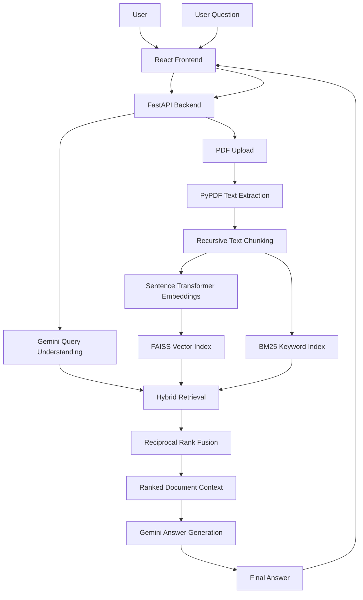

# Enterprise RAG Chatbot

### AI-Powered Document Question Answering System Using Retrieval-Augmented Generation

An AI-powered document question-answering application that allows users to upload PDF documents and ask questions about their contents using natural language.

The application uses **Retrieval-Augmented Generation (RAG)** to retrieve relevant information from uploaded documents and generate context-based answers using Google's Gemini API.

It combines **FAISS semantic search**, **BM25 keyword retrieval**, and **Reciprocal Rank Fusion (RRF)** to improve document retrieval and provides a React-based interface connected to a FastAPI backend.

The primary objective is to provide an intelligent document assistant that answers questions using information retrieved from the uploaded documents rather than relying on general-purpose knowledge.

---

## Table of Contents

1. [Project Overview](#project-overview)
2. [Problem Statement](#problem-statement)
3. [Project Objectives](#project-objectives)
4. [Key Features](#key-features)
5. [Technology Stack](#technology-stack)
6. [System Architecture](#system-architecture)
7. [How the RAG Pipeline Works](#how-the-rag-pipeline-works)
8. [Hybrid Search Implementation](#hybrid-search-implementation)
9. [Project Structure](#project-structure)
10. [Prerequisites](#prerequisites)
11. [Installation and Setup](#installation-and-setup)
12. [Environment Configuration](#environment-configuration)
13. [Running the Application](#running-the-application)
14. [API Documentation](#api-documentation)
15. [Example Usage](#example-usage)
16. [Configuration Details](#configuration-details)
17. [Error Handling](#error-handling)
18. [Security and Privacy](#security-and-privacy)
19. [Current Limitations](#current-limitations)
20. [Future Enhancements](#future-enhancements)
21. [Learning Outcomes](#learning-outcomes)
22. [Author](#author)

---

## 1. Project Overview

The Enterprise RAG Chatbot is a full-stack Generative AI application designed to make information stored in PDF documents easier to access.

Traditional document searching requires users to manually read through lengthy documents to locate specific information. This application simplifies that process by allowing users to ask questions in natural language.

The system processes uploaded PDF documents, extracts their text, divides the content into smaller chunks, generates vector embeddings, and stores the resulting document representations in a FAISS vector index.

When a user submits a question, the application:

- Understands and reformulates the question using Gemini.
- Retrieves potentially relevant document passages using FAISS and BM25.
- Combines retrieval rankings using Reciprocal Rank Fusion.
- Passes the retrieved context to Gemini.
- Generates a response based on the available document information.
- Displays the final answer in the React interface.

The application is built using a modular architecture, separating the frontend, backend, document processing, embedding generation, retrieval, and answer-generation responsibilities.

## 2. Problem Statement

Organizations and individuals often store important information in PDF documents, reports, resumes, technical manuals, policies, and other unstructured files.

Finding specific information in these documents can be time-consuming, particularly when:

- Documents contain many pages.
- Information is distributed across multiple sections.
- Users do not know the exact keywords used in the document.
- Traditional keyword searches cannot understand semantic meaning.
- Users need direct answers rather than entire paragraphs of extracted text.

The objective of this project is to address these challenges by building a conversational document assistant using Retrieval-Augmented Generation.

Instead of depending exclusively on an LLM's pre-trained knowledge, the application retrieves relevant information from the uploaded document and uses that retrieved content as context for answer generation.

## 3. Project Objectives

The main objectives of this project are:

1. Develop a web application for uploading and processing PDF documents.
2. Extract text from PDF files programmatically.
3. Implement intelligent document chunking for efficient retrieval.
4. Generate semantic embeddings using Sentence Transformers.
5. Implement vector-based semantic search using FAISS.
6. Implement keyword-based retrieval using BM25.
7. Combine semantic and keyword retrieval using Reciprocal Rank Fusion.
8. Integrate Gemini for natural-language question understanding and response generation.
9. Build a responsive React frontend connected to a FastAPI backend.
10. Generate concise answers using the retrieved document context.

---

## 4. Key Features

### PDF Document Processing

- Upload PDF documents through the web interface.
- Validate file extensions and file sizes.
- Extract text using PyPDF.
- Process extracted text into smaller document chunks.
- Preserve page-related text markers where available.

### Intelligent Text Chunking

- Uses Recursive Character Text Splitting.
- Divides long documents into manageable chunks.
- Maintains overlap between adjacent chunks to preserve context.
- Prepares extracted text for embedding generation and retrieval.

### Semantic Search Using FAISS

- Generates vector embeddings using Sentence Transformers.
- Stores document embeddings in a FAISS index.
- Retrieves semantically similar document passages.
- Uses normalized embeddings and inner-product similarity.

### Keyword Search Using BM25

- Implements BM25Okapi for keyword-based document retrieval.
- Tokenizes documents for keyword matching.
- Identifies passages containing relevant query terms.

### Hybrid Retrieval

- Combines semantic retrieval and keyword retrieval.
- Uses Reciprocal Rank Fusion to combine rankings.
- Applies an experience-aware ranking adjustment for selected training and internship queries.
- Returns the highest-ranked document chunks.

### Gemini Integration

- Uses Google's Gemini API for question understanding.
- Reformulates natural-language queries for document retrieval.
- Generates answers using retrieved document context.
- Includes retry handling for temporary API errors.
- Uses document-grounding instructions to discourage unsupported answers.

### Interactive Chat Interface

- React-based user interface.
- PDF upload functionality.
- Natural-language question input.
- AI-generated answer display.
- Loading and error indicators.
- Backend connection status.
- Duplicate submission protection.

---

## 5. Technology Stack

| Category | Technology | Purpose |
|---|---|---|
| Frontend | React.js | User interface |
| Frontend tooling | Vite | Development server and frontend build |
| Programming language | JavaScript | Frontend functionality |
| Styling | CSS | Application styling |
| Backend | Python | Application logic |
| Backend framework | FastAPI | REST API development |
| PDF processing | PyPDF | PDF text extraction |
| Text splitting | LangChain Text Splitters | Document chunking |
| Embeddings | Sentence Transformers | Semantic vector generation |
| Embedding model | all-MiniLM-L6-v2 | Text embeddings |
| Vector database/index | FAISS | Semantic similarity search |
| Keyword retrieval | rank-bm25 | BM25 keyword search |
| LLM | Google Gemini | Query understanding and answer generation |
| API communication | Fetch API | React-to-FastAPI communication |
| Environment management | python-dotenv | Environment variable configuration |
| ASGI server | Uvicorn | FastAPI application server |

### Important Libraries

**FastAPI**

Provides the backend REST API and handles communication between the React frontend and the document-processing pipeline.

**Sentence Transformers**

Converts document chunks and user queries into numerical vector representations.

**FAISS**

Provides efficient similarity search over the generated document embeddings.

**BM25Okapi**

Implements keyword-based retrieval to identify passages containing relevant terms.

**Google Gen AI SDK**

Connects the Python backend to Google's Gemini models for query reformulation and answer generation.

**LangChain Text Splitters**

Provides recursive text splitting to create overlapping document chunks.

---

## 6. System Architecture

The application follows a modular Retrieval-Augmented Generation architecture.

### High-Level Architecture



### Architectural Components

**Frontend Layer**

Responsible for:

- Displaying the application interface.
- Accepting PDF uploads.
- Collecting user questions.
- Sending HTTP requests to the backend.
- Displaying generated answers and error messages.

**API Layer**

FastAPI provides endpoints for:

- Backend health checks.
- PDF upload and processing.
- Document search.
- Chat and answer generation.

**Document Processing Layer**

Extracts text from uploaded PDF files and splits the extracted content into manageable chunks.

**Embedding Layer**

Uses Sentence Transformers to convert document chunks into vector embeddings.

**Retrieval Layer**

Combines FAISS semantic retrieval with BM25 keyword retrieval and uses RRF to produce a ranked set of candidate passages.

**Generation Layer**

Uses Gemini to understand user questions and generate answers using the retrieved document context.

---

## 7. How the RAG Pipeline Works

The project follows a two-stage process: document indexing and question answering.

### Stage A: Document Indexing

**Step 1: PDF Upload**

The user selects and uploads a PDF file through the React frontend.

**Step 2: Text Extraction**

The FastAPI backend receives the file and extracts its textual content using PyPDF.

**Step 3: Text Chunking**

The extracted text is divided into smaller chunks using Recursive Character Text Splitting.

Current chunking configuration:

| Parameter | Value |
|---|---:|
| Chunk size | 500 characters |
| Chunk overlap | 100 characters |
| Splitting strategy | Recursive |
| Separators | Paragraph, newline, space and character |

The overlap helps preserve context between consecutive chunks.

**Step 4: Embedding Generation**

Each document chunk is converted into a numerical vector using:

`sentence-transformers/all-MiniLM-L6-v2`

The resulting embeddings are normalized before indexing.

**Step 5: FAISS Index Creation**

The embeddings are stored in a FAISS `IndexFlatIP` index.

The application uses normalized vectors and inner-product similarity for semantic retrieval.

**Step 6: BM25 Index Creation**

The document chunks are tokenized and indexed using BM25Okapi.

The FAISS index and document chunks are saved locally for subsequent searches.

### Stage B: Question Answering

**Step 1: User Question**

The user enters a natural-language question through the React interface.

**Step 2: Query Understanding**

Gemini receives the original question and reformulates it into a clearer, self-contained search query.

If query reformulation fails, the system falls back to the original question.

**Step 3: Hybrid Retrieval**

The original and reformulated questions are combined for retrieval.

FAISS performs semantic search, while BM25 performs keyword-based search.

**Step 4: Ranking Combination**

Reciprocal Rank Fusion combines the semantic and keyword ranking results.

**Step 5: Context Preparation**

The highest-ranked document chunks are selected and passed to the answer-generation layer.

**Step 6: Answer Generation**

Gemini receives the user question and retrieved document context.

It generates a concise response using the supplied context and document-grounding instructions.

**Step 7: Frontend Response**

FastAPI returns the answer to React, which displays the final response to the user without displaying the retrieved source chunks.

---

## 8. Hybrid Search Implementation

One of the important technical components of this project is hybrid retrieval.

Semantic search and keyword search use different approaches to identify relevant document content.

### A. Semantic Search – FAISS

Semantic search uses vector representations of text.

It is useful when the user's question and the document passage express similar meanings using different words.

The application uses:

- Sentence Transformers for embedding generation.
- `all-MiniLM-L6-v2` as the embedding model.
- FAISS `IndexFlatIP` for similarity search.
- Normalized embeddings for cosine-similarity-style comparison using inner product.

### B. Keyword Search – BM25

BM25 identifies relevant passages based on query-token matches.

It helps retrieve passages containing important names, technical terms, organizations, and other specific keywords.

The project uses:

`BM25Okapi`

### C. Reciprocal Rank Fusion

FAISS and BM25 produce separate rankings.

Reciprocal Rank Fusion combines their rankings using:

\[
RRF(d) = \sum_{r \in R} \frac{1}{k + rank_r(d)}
\]

Where:

- `d` represents a document chunk.
- `R` represents the retrieval systems.
- `rank_r(d)` represents the position of the chunk in a retrieval ranking.
- `k` is the RRF constant.

The implementation uses:

`k = 60`

RRF helps combine semantic and keyword retrieval without requiring their raw similarity scores to use the same scale.

### D. Experience-Aware Ranking

The retrieval layer also includes a small ranking adjustment for selected query categories.

Examples include:

- Data Science internship-related questions.
- Python Full Stack training-related questions.

This adjustment is used only to influence the ranking of retrieved passages. It does not create new document information or determine the final answer.

---

## 9. Project Structure

```text
Enterprise-RAG-Chatbot/
│
├── backend/
│   │
│   ├── main.py
│   ├── gemini_service.py
│   ├── document_processor.py
│   ├── embedding_service.py
│   ├── vector_store.py
│   │
│   ├── requirements.txt
│   ├── .env.example
│   │
│   └── vector_store/
│       ├── company.index
│       └── chunks.json
│
├── frontend/
│   │
│   ├── public/
│   │
│   ├── src/
│   │   ├── assets/
│   │   ├── App.jsx
│   │   ├── App.css
│   │   ├── index.css
│   │   ├── api.js
│   │   └── main.jsx
│   │
│   ├── index.html
│   ├── package.json
│   ├── package-lock.json
│   └── vite.config.js
│
├── .gitignore
└── README.md
```

### Backend File Responsibilities

| File | Responsibility |
|---|---|
| `main.py` | FastAPI application and REST endpoints |
| `gemini_service.py` | Gemini query reformulation and answer generation |
| `document_processor.py` | Document text splitting |
| `embedding_service.py` | Sentence Transformer model and embeddings |
| `vector_store.py` | FAISS, BM25, hybrid retrieval and ranking |
| `requirements.txt` | Python dependencies |
| `.env.example` | Environment variable template |

### Frontend File Responsibilities

| File | Responsibility |
|---|---|
| `App.jsx` | Main React application |
| `App.css` | Chatbot component styling |
| `index.css` | Global styling |
| `api.js` | Backend API communication |
| `main.jsx` | React entry point |

**Note:** `company.index` and `chunks.json` are generated runtime files. They should normally be created locally rather than committed to a public repository.

---

## 10. Prerequisites

Before installing the application, make sure the following tools are available:

| Tool | Purpose |
|---|---|
| Python 3.12 | Backend development |
| Node.js and npm | Frontend development |
| Git | Version control |
| Google Gemini API key | LLM access |
| Code editor | Development and maintenance |

Python packages and JavaScript dependencies are installed separately for the backend and frontend.

---

## 11. Installation and Setup

Follow these steps to run the project locally on Windows.

### Step 1: Clone the Repository

```powershell
git clone https://github.com/YOUR_USERNAME/Enterprise-RAG-Chatbot.git

cd Enterprise-RAG-Chatbot
```

Replace `YOUR_USERNAME` with your GitHub username.

### Step 2: Create the Python Virtual Environment

```powershell
cd backend

python -m venv venv
```

Activate the virtual environment:

```powershell
.\venv\Scripts\Activate.ps1
```

If PowerShell blocks activation, use an appropriately configured shell or adjust the execution policy according to your local security requirements.

### Step 3: Install Backend Dependencies

```powershell
pip install -r requirements.txt
```

### Step 4: Configure Environment Variables

Create a `.env` file inside the backend folder.

Add:

```env
GEMINI_API_KEY=your_actual_gemini_api_key
```

Use your own Gemini API key. Never commit the actual `.env` file.

### Step 5: Install Frontend Dependencies

Open another terminal:

```powershell
cd frontend

npm install
```

### Step 6: Start the Backend

From the backend directory, with the virtual environment activated:

```powershell
python -m uvicorn main:app --reload --host 127.0.0.1 --port 8000
```

The backend will be available at:

`http://127.0.0.1:8000`

### Step 7: Start the Frontend

In another terminal:

```powershell
cd frontend

npm run dev
```

The frontend will normally be available at:

`http://localhost:5173`

Open the frontend URL in your web browser.

---

## 12. Environment Configuration

The backend uses environment variables for external API configuration.

### `.env` File

```env
GEMINI_API_KEY=your_actual_gemini_api_key
```

### `.env.example`

For GitHub, include only a safe template:

```env
GEMINI_API_KEY=your_gemini_api_key_here
```

### Hugging Face Model Cache

Sentence Transformers downloads its embedding model when needed.

To store the Hugging Face model cache on the D drive in Windows PowerShell:

```powershell
New-Item -ItemType Directory -Force D:\Enterprise-RAG-Chatbot\models

$env:HF_HOME = "D:\Enterprise-RAG-Chatbot\models\huggingface"
```

To make the setting available in future terminal sessions:

```powershell
setx HF_HOME "D:\Enterprise-RAG-Chatbot\models\huggingface"
```

Restart the terminal after using `setx`.

---

## 13. Running the Application

The application requires two running processes.

### Backend Terminal

```powershell
cd D:\Enterprise-RAG-Chatbot\backend

.\venv\Scripts\Activate.ps1

python -m uvicorn main:app --reload --host 127.0.0.1 --port 8000
```

### Frontend Terminal

```powershell
cd D:\Enterprise-RAG-Chatbot\frontend

npm run dev
```

### Application URLs

| Service | URL |
|---|---|
| React frontend | http://localhost:5173 |
| FastAPI backend | http://127.0.0.1:8000 |
| Backend health check | http://127.0.0.1:8000/health |
| Swagger API documentation | http://127.0.0.1:8000/docs |

---

## 14. API Documentation

The FastAPI backend exposes endpoints for health checks, PDF processing, document retrieval, and question answering.

### 1. Root Endpoint

**Method:** `GET`

**Route:**

`/`

Used to verify that the backend application is responding.

### 2. Health Check

**Method:** `GET`

**Route:**

`/health`

Used by the frontend to check backend connectivity.

### 3. Upload PDF

**Method:** `POST`

**Route:**

`/upload-pdf`

Accepts a PDF file through multipart form data.

The backend:

1. Validates the uploaded file.
2. Extracts PDF text.
3. Splits extracted text into chunks.
4. Generates embeddings.
5. Creates the FAISS index.
6. Creates the BM25 index.
7. Saves the generated index and chunks locally.

Example request using PowerShell:

```powershell
$form = @{
    file = Get-Item "C:\path\to\document.pdf"
}

Invoke-RestMethod `
    -Uri "http://127.0.0.1:8000/upload-pdf" `
    -Method POST `
    -Form $form
```

### 4. Document Search

**Method:** `POST`

**Route:**

`/search`

Accepts a natural-language question and returns the highest-ranked retrieved document passages.

Example request:

```json
{
  "question": "Where did the candidate complete Python training?"
}
```

The search response includes retrieved chunks and retrieval metadata, such as ranking scores and matching methods.

This endpoint is primarily useful for retrieval testing and debugging.

### 5. Chat

**Method:** `POST`

**Route:**

`/chat`

Accepts a question, retrieves document context and generates an answer using Gemini.

Example request:

```json
{
  "question": "Where did the candidate complete Python training?"
}
```

The response contains the generated answer and source information returned by the backend. The React interface displays only the final answer.

### Interactive API Documentation

FastAPI automatically provides Swagger documentation at:

`http://127.0.0.1:8000/docs`

The endpoints can be tested directly through this interface.

---

## 15. Example Usage

### Example 1: Training Information

**Question:**

Where did Yashwanth complete his Python Full Stack training?

**Expected type of response:**

Yashwanth completed his Python Full Stack training at Palle Technologies in Bengaluru.

### Example 2: Internship Information

**Question:**

Where did Yashwanth complete his Data Science internship?

**Expected type of response:**

The answer should identify the internship organization using the retrieved document information.

### Example 3: Technical Skills

**Question:**

Which technologies are mentioned in the document?

**Expected type of response:**

The answer should list only technologies supported by the retrieved document passages.

### Example 4: Unavailable Information

**Question:**

A question about information that does not appear in the uploaded document.

**Expected response:**

The provided documents do not contain enough information to answer this question.

### Example 5: Unrelated Question

**Question:**

What is today's weather?

The application is designed for document-based question answering, not general-purpose conversations. A separate relevance-validation mechanism is needed to reliably reject all unrelated questions.

---

## 16. Configuration Details

### Document Chunking

The application currently uses:

```python
chunk_size=500
chunk_overlap=100
```

The chunk size and overlap can be adjusted according to document characteristics and retrieval quality.

### Embedding Model

```python
sentence-transformers/all-MiniLM-L6-v2
```

This model generates 384-dimensional sentence embeddings.

### FAISS Configuration

```python
faiss.IndexFlatIP(dimension)
```

The application normalizes embeddings before adding them to the FAISS index.

### BM25 Configuration

The project uses:

```python
BM25Okapi(tokenized_chunks)
```

The BM25 index is constructed from tokenized document chunks.

### Hybrid Retrieval

The retrieval system uses a candidate limit based on the requested number of results:

```python
candidate_k = min(
    max(top_k * 3, 10),
    index.ntotal
)
```

The semantic and keyword rankings are combined using RRF with a constant of 60.

### Gemini Configuration

The model is configured in `gemini_service.py`:

```python
MODEL_NAME = "gemini-3.5-flash-lite"
```

The model name can be changed according to the models available to the configured Gemini API account.

---

## 17. Error Handling

The project includes basic validation and error handling across the frontend and backend.

Examples include:

| Error condition | Handling |
|---|---|
| Empty question | Reject the request |
| Invalid PDF extension | Reject the upload |
| PDF larger than configured limit | Reject the upload |
| Empty document text | Reject indexing |
| Missing Gemini API key | Stop backend initialization |
| Missing FAISS index | Request document upload |
| Missing chunk data | Report unavailable document data |
| Empty Gemini response | Raise an error |
| Temporary Gemini API failure | Retry with exponential waiting |
| Backend unavailable | Display connection error in React |

### Gemini Retry Handling

The generation service retries selected temporary failures, including common service availability, rate-limit and internal-server errors.

The retry delays increase between attempts to avoid repeatedly calling an unavailable service immediately.

---

## 18. Security and Privacy

The project uses an API key to communicate with Google's Gemini service.

Follow these practices when running or publishing the application:

- Store API keys in environment variables.
- Never upload `.env` files to public GitHub repositories.
- Keep `.env.example` free from real credentials.
- Do not commit private PDF documents.
- Do not commit `chunks.json` containing extracted personal information.
- Do not publish local FAISS indexes generated from private documents.
- Do not expose API credentials in frontend JavaScript.
- Validate uploaded files on the backend, not only in the frontend.

### Recommended `.gitignore`

```gitignore
# Python
__pycache__/
*.py[cod]
venv/
.venv/

# Environment variables
.env
.env.*
!.env.example

# Frontend
node_modules/
dist/

# Generated RAG data
backend/vector_store/
backend/uploads/
models/

*.index
*.faiss

# PDF documents
*.pdf

# IDE and operating system files
.idea/
.vscode/
.DS_Store
Thumbs.db
```

---

## 19. Current Limitations

The current implementation is a locally runnable portfolio project and has not been presented as production-ready enterprise software.

Known limitations include:

1. **Single active document index:** The current indexing flow uses a saved FAISS index and chunk file. Uploading a new PDF can replace the previous active index rather than maintaining a complete document library.

2. **Local storage:** The vector index and document chunks are stored on the local filesystem.

3. **Retrieval relevance:** Hybrid retrieval may return irrelevant passages, so retrieval quality must be evaluated with representative test questions.

4. **Answer grounding:** Gemini receives retrieved document context and grounding instructions. Prompt instructions alone do not mathematically guarantee that every generated claim is supported.

5. **Relevance validation:** A dedicated, independently evaluated relevance threshold and evidence-validation gate remains a future improvement.

6. **Authentication:** User authentication, authorization and role-based document access are not implemented.

7. **Scalability:** The current local FAISS setup is intended for a development and demonstration environment rather than a large multi-user deployment.

8. **Deployment:** Cloud deployment, production monitoring and automated CI/CD are not included in the current version.

9. **Document formats:** The current upload workflow is designed for PDF files.

10. **Session-level frontend information:** The frontend's displayed upload information is maintained in browser state and is not a persistent document-management database.

---

## 20. Future Enhancements

Potential improvements include:

- Multiple PDF document management.
- Persistent document metadata and database integration.
- Document-specific search filters.
- Dedicated retrieval relevance evaluation.
- Evidence validation before answer generation.
- Citation and source highlighting.
- Improved table and structured-data extraction.
- Streaming AI responses.
- User authentication and authorization.
- Cloud deployment.
- Docker-based application packaging.
- Automated testing.
- Application logging and monitoring.
- Evaluation of retrieval precision and answer quality.

These enhancements can help evolve the current prototype into a more robust enterprise-oriented document assistant.

---

## 21. Learning Outcomes

This project provides hands-on experience in several areas of software development and Generative AI.

### Python Backend Development

- Building REST APIs with FastAPI.
- Designing modular Python services.
- Handling PDF uploads.
- Managing file storage and application errors.
- Integrating external APIs.

### Natural Language Processing

- Text extraction and preprocessing.
- Recursive document chunking.
- Semantic embeddings.
- Query understanding.
- Similarity-based retrieval.

### Information Retrieval

- FAISS vector indexing.
- BM25 keyword ranking.
- Hybrid search architecture.
- Reciprocal Rank Fusion.
- Retrieval ranking adjustments.

### Generative AI

- Integrating Google's Gemini API.
- Building a Retrieval-Augmented Generation pipeline.
- Preparing retrieved context for LLM prompts.
- Designing document-grounded answer-generation instructions.
- Handling API failures and retries.

### Full-Stack Development

- Building a React application.
- Connecting frontend and backend using HTTP requests.
- Managing component state.
- Handling asynchronous operations.
- Designing an interactive chat interface.

---

## 22. Author

**Developed by: Yashwanth K**

GitHub: [https://github.com/Yashwanth-12-yash](https://github.com/Yashwanth-12-yash)

LinkedIn: [Add your LinkedIn profile URL]

### Project

**Enterprise RAG Chatbot**

A Generative AI and Full Stack Development portfolio project demonstrating document processing, hybrid information retrieval, LLM integration, and conversational question answering.

---

## Acknowledgements

This project uses open-source libraries and technologies including React, FastAPI, Sentence Transformers, FAISS, BM25, PyPDF, and LangChain Text Splitters.

Gemini API is used for natural-language query understanding and answer generation.

---

**Thank you for exploring the Enterprise RAG Chatbot!**